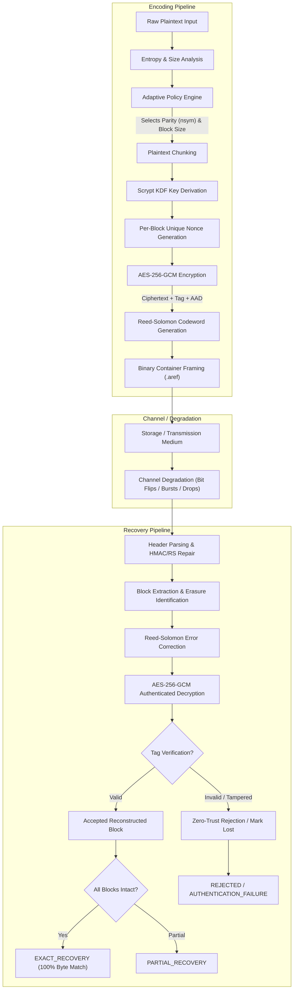

# CryptoMend: Architecture & Threat Model

## 1. Overview and Problem Statement

When storing or transmitting encrypted files over lossy or degraded channels (e.g., flash memory wear, deep archival tape, noisy wireless links, cosmic ray bit-flips), traditional authenticated symmetric ciphers such as AES-GCM or ChaCha20-Poly1305 face an inherent security challenge:

> **The Integrity Paradox:** Modern Authenticated Encryption with Associated Data (AEAD) is deliberately designed to fail completely upon any modification of ciphertext or authentication tags to guarantee integrity. However, this property causes catastrophic data loss if channel noise corrupts even a single bit of a legitimate file.

Encryption **never** repairs corrupted data. This project solves this fundamental problem through a defensible layered architecture combining **AES-256-GCM authenticated encryption** and **Reed–Solomon forward error correction (FEC)** across adaptive risk tiers.

---

## 2. System Data Flow

---

## 3. Cryptographic Implementation Details

### A. Key Derivation (scrypt)
- **Algorithm:** scrypt (RFC 7914) via OpenSSL/`cryptography`
- **Salt:** 16 bytes cryptographically secure random (`os.urandom(16)`)
- **Parameters:**
  - $N = 16384$ ($2^{14}$)
  - $r = 8$
  - $p = 1$
  - Output key length: 32 bytes (256-bit AES key)
- **Properties:** Memory-hard against GPU and ASIC brute-force attacks.

### B. Authenticated Encryption (AES-256-GCM)
- **Cipher:** AES in Galois/Counter Mode (AES-GCM), 256-bit key
- **Nonce Strategy:**
  - 12-byte Master Nonce generated randomly per file.
  - Per-Block Nonce: Deterministically derived by XORing the lower 4 bytes of the master nonce with a 32-bit big-endian monotonic block counter:
    $$\text{Nonce}_i = \text{MasterNonce}[0..8] \parallel (\text{MasterNonce}[8..12] \oplus \text{uint32}(i))$$
  - Guarantees **zero IV reuse** under any key.
- **Associated Authenticated Data (AAD):**
  - $\text{AAD}_i = \text{uint32}(i) \parallel \text{uint16}(\text{length}_i)$
  - Binds block index and length to prevent block reordering or truncation attacks.

---

## 4. Error Correction Mechanics: Reed–Solomon GF(2^8)

Reed–Solomon operates over the Galois Field $\text{GF}(2^8)$ where each symbol is a byte ($0 \dots 255$).
- **Maximum Codeword Size:** $n = 255$ bytes.
- **Data Symbols:** $k = n - nsym$.
- **Error vs Erasure Capabilities:**
  - **Unknown Symbol Errors ($t$):** Can correct up to $t = \lfloor nsym / 2 \rfloor$ corrupted bytes at unknown positions.
  - **Known Erasures ($e$):** Can correct up to $e = nsym$ missing bytes at known offsets.
  - **General Condition:** $2t + e \le nsym$.

### Protection Tiers

| Strategy | Risk Tier | Parity Symbols ($nsym$) | Data Capacity per Block ($k$) | Max Random Byte Errors ($t$) | Max Known Erasures ($e$) | Typical Parity Overhead |
|---|---|---|---|---|---|---|
| **None** | Baseline | 0 | 233 bytes | 0 | 0 | 0.0% |
| **Fixed** | Medium | 32 | 201 bytes | 16 bytes | 32 bytes | ~15.9% |
| **Adaptive (Low)** | Low Risk | 16 | 217 bytes | 8 bytes | 16 bytes | ~7.4% |
| **Adaptive (Med)** | Medium Risk | 32 | 201 bytes | 16 bytes | 32 bytes | ~15.9% |
| **Adaptive (High)** | High Risk | 64 | 169 bytes | 32 bytes | 64 bytes | ~37.9% |

---

## 5. Threat Model and Security Guarantees

### Adversary Capabilities
1. **Passive Channel Corrupter:** Random cosmic-ray bit flips, disk sector decay, packet loss.
2. **Active Malicious Interceptor:** Modifies ciphertext bytes, deletes blocks, truncates files, alters metadata.
3. **Chosen-Ciphertext Attacker:** Submits forged or mangled containers to trigger decryption Oracle responses.

### Security Guarantees
1. **Confidentiality:** Guaranteed by AES-256-GCM. Unreconstructed or partially recovered data yields zero information on missing plaintexts.
2. **Zero Silent Incorrect Acceptance:** If corruption exceeds Reed-Solomon capacity, RS either flags an uncorrectable state or miscorrects to invalid ciphertext. The 128-bit AES-GCM authentication tag verifies the result; false tag acceptance occurs with probability at most $2^{-128} \approx 2.9 \times 10^{-39}$. In all benchmarks and evaluations, silent incorrect acceptance is strictly **0.0%**.
3. **Replay & Frame Swapping Defense:** Per-block nonces and AAD binding ensure blocks cannot be spliced or substituted across different positions or files.
